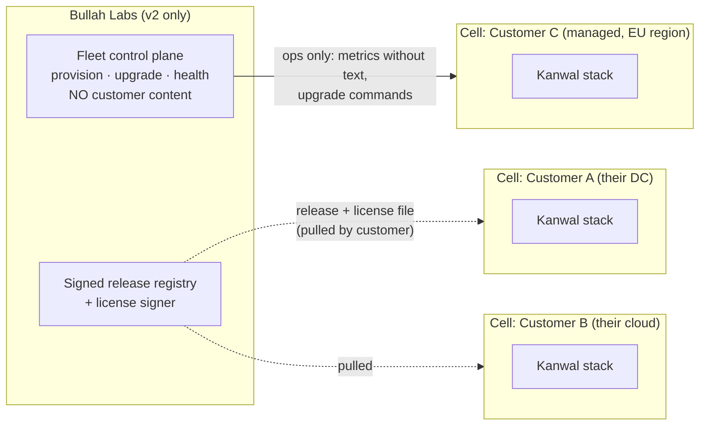
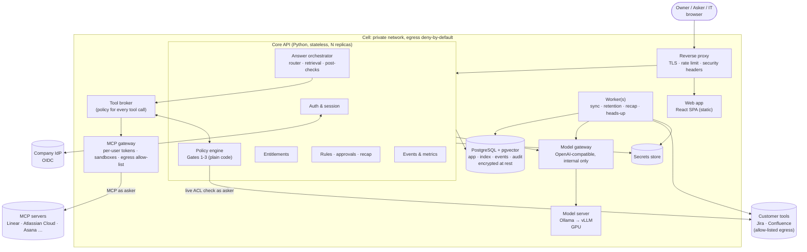
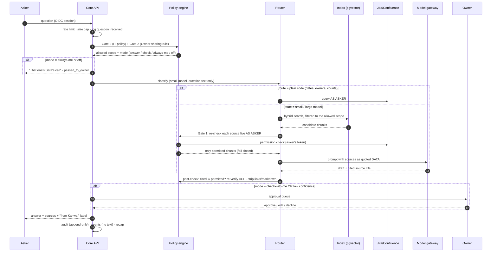
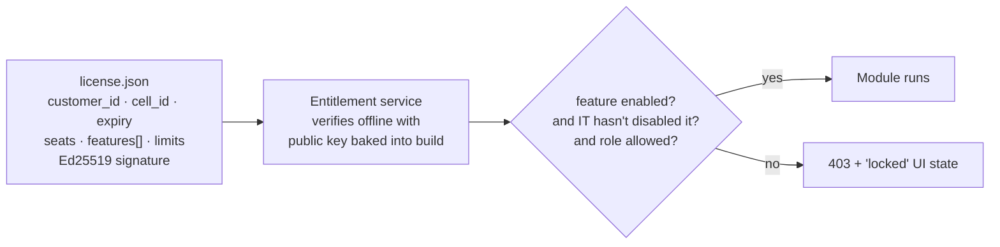
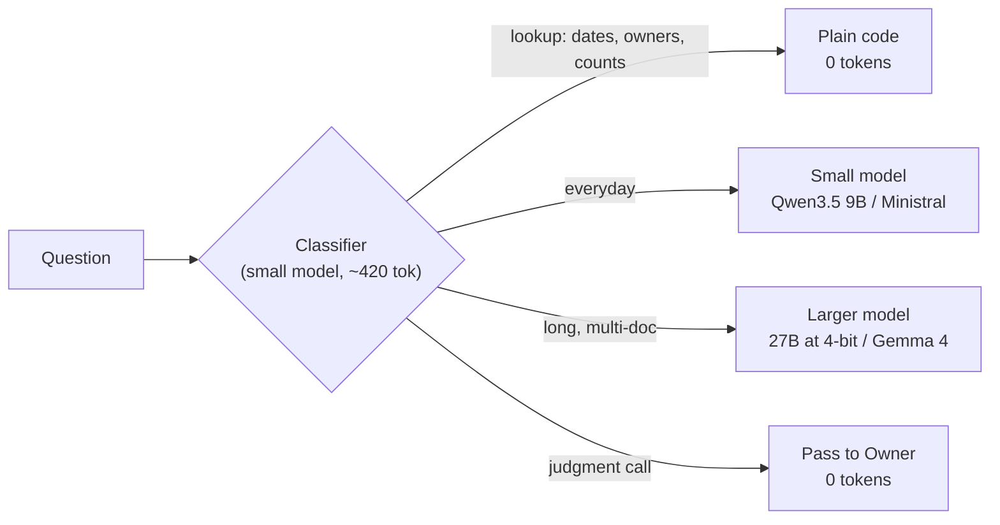

# 01. System architecture (DRAFT)

Implements the requirements in [product/01-requirements.md](../../product/01-requirements.md) and the rules in [product/02-product-rules.md](../../product/02-product-rules.md). Security detail is in [02-security-architecture.md](./02-security-architecture.md).

Diagrams are Mermaid. They render in GitHub and in VS Code's Markdown preview.

## ARCH-0. The core idea: a platform made of identical "cells"

"Platform" and "scale" usually suggest one big shared multi-tenant SaaS. Our requirements rule that out. Data must stay on the customer's servers or in their chosen region, nothing calls home, and models run locally.

So the unit of deployment is a **cell**: one customer, one isolated stack, one database, one model server.

- **Scale out** by adding cells. One customer never shares a database, GPU, or network with another.
- **Scale up** inside a cell: more API replicas, more workers, vLLM, more GPUs.
- **The same signed artifact** runs in all three hosting modes:

| Mode | When | Who runs the cell | Control plane |
|------|------|-------------------|---------------|
| On-prem | v0 | Customer IT | None. Licensing is offline |
| Customer cloud | v1 | Customer IT, with our help | None |
| Managed (one cell per customer) | v2 | Us | Our fleet control plane: provisioning, upgrades, health checks. **It never sees customer content** |



Why this scales safely:
- **Blast radius = 1 customer.** A bug or a breach in one cell can't reach another.
- **No cross-tenant query paths exist at all.** That's stronger than row-level tenant filters.
- **Compliance is easier.** Data residency is a property of where you put the cell.
- **Cost:** a cell is roughly €214/month (1× 24 GB GPU) for ~10 Owners. That's fine for B2B pricing.

New here? Read [00 Overview](./00-overview.md) first.

Local and cloud deployment profiles (`local`, `private-cloud`, `managed`) are detailed in **[04 Deployment](./04-deployment.md)**. The privacy promises that every profile must keep are in **[06 Privacy-first architecture](./06-privacy-architecture.md)**.

The trade-off: a fleet of many small installs is harder to operate than one SaaS. That's why the v2 control plane matters, and why "install in < 1 h" (NFR-03) is an architecture requirement, not a docs task.

## ARCH-1. Inside a cell (v0)

A **modular monolith**, not microservices. We have 264 hours. Module boundaries are strict in code so we can split them later if load demands it.



| Component | Choice | Notes |
|-----------|--------|-------|
| Web | React SPA, static build | Keyboard-first, SSE streaming. See [D-07](../../product/03-decisions-and-questions.md) on Next.js |
| Core API | Python (FastAPI) | Policy and access checks live here, in plain code, with typed models |
| Worker | Same codebase, different entrypoint | Postgres-backed queue (`SELECT … FOR UPDATE SKIP LOCKED`), so there's **no Redis in v0** |
| Database | PostgreSQL 16+ with pgvector | Separate schemas: `app`, `index`, `events`, `audit`. RLS turned on as defense in depth |
| Model gateway | Thin internal module | One place for routing, token accounting, timeouts, and output caps |
| Model server | Ollama (v0) → vLLM (> ~5 concurrent users) | Bound to the private network only, telemetry off |
| Secrets | Docker secrets / file-mounted (v0) → Vault or cloud KMS (v1) | Connector tokens are encrypted with an envelope key |
| Packaging | Docker Compose, signed images | Helm chart in v1 for the customer-cloud mode |
| Observability | Local logs plus a local dashboard (e.g. Grafana) | Nothing leaves the cell |

## ARCH-2. Life of a question (the critical path)

Every question follows this path. **Any error at any step means nothing gets sent.**



Rules that make this safe:
1. **The model never decides access.** It sees only chunks that already passed all three gates.
2. **There are two ACL checks.** One happens before retrieval, one before send, because permissions can change in between.
3. **Citations are verified.** If the model cites a source it wasn't given, or cites nothing, the answer goes to the Owner instead of being sent.
4. **The model has no tools in v0.** It can't trigger anything, so injected instructions have nothing to call.

## ARCH-3. Connector framework (integrations at scale)

> **Full design: [03 Integrations and MCP](./03-integrations-and-mcp.md).** That doc covers native, MCP, and hybrid adapters, the MCP gateway and tool broker, the default-deny tool lifecycle, and per-call authorization. The sketch below is the original v0 summary. Where they differ, 03 wins.

We'll have many integrations (Jira, Confluence, Linear, Slack, Teams, email, Drive, …). Each one is a plugin with a strict contract, split by **what it is allowed to do**:

| Kind | Purpose | Examples | Direction |
|------|---------|----------|-----------|
| **Source** | Content we index and answer from | Jira, Confluence, Linear, Drive, SharePoint | Read-only |
| **Channel** | Where questions arrive and answers go | Web app (v0), Slack, Teams, email (v1) | In and out, rate-limited |
| **Action** | Change something outside | Create a ticket, send an email | **Not in v0.** Always approval-gated |

```python
# Sketch of the contract, not final
class SourceConnector(Protocol):
    kind: Literal["source"]
    capabilities: set[Capability]          # e.g. {"read", "acl_check_live", "webhooks"}

    def authorize(self, owner_or_asker) -> OAuthGrant: ...        # per-user consent (one time)
    def sync(self, cursor: Cursor) -> Iterator[DocChange]: ...    # incremental: upsert + DELETE
    def check_access(self, user_grant, resource_ids) -> dict[str, bool]: ...  # live, as the user
    def fetch(self, user_grant, resource_id) -> Document: ...     # as the user
    rate_limit: RateLimitPolicy
```

Rules for every connector:
- **Live access check is mandatory** (`check_access`). If a source can't do one, it can't be used for cover mode. Confluence Data Center is the open risk here (see [D-03](../../product/03-decisions-and-questions.md)).
- **Deletes propagate.** Sync must emit deletes and restrictions, and the index must drop them on the next run.
- **Per-user OAuth** for access checks. A service account is used only for sync, and it is read-only.
- **Channels in a cell need no inbound internet.** For example, Slack uses Socket Mode (an outbound WebSocket), so the cell never opens a public port. Teams routes through Azure Bot Service, so data passes through Microsoft. We need to flag that to buyers (open risk in the source doc).
- Each connector is versioned and behind an entitlement key (`connector.linear`).

## ARCH-4. Entitlements: locked and unlocked features

> **Full design: [05 Feature control and customization](./05-feature-control-and-customization.md).** That doc covers seven narrowing layers (build → license → profile → IT → role → Owner → user), the feature registry, kill switches, customization levels, and Cedar policies. Below is the license layer only.

A cell can't call home to check a subscription, so entitlements come from a **signed license file**.



- Feature keys are a namespace: `core.chat`, `core.cover`, `heads_up`, `inbox`, `connector.slack`, `persona.pm`, `persona.eng_lead`, and so on.
- **Effective access = license ∩ IT policy ∩ role.** IT can turn off what the license allows. Nobody can turn on what the license doesn't allow.
- Enforcement lives in the API layer, as a decorator on routes and jobs. The UI only reflects it.
- Expiry has a grace period plus read-only mode. It **never deletes data** and never fails open.
- Managed cells (v2) get license updates from the fleet control plane. On-prem cells get a new file.

## ARCH-5. Data architecture

| Schema | Holds | Notes |
|--------|-------|-------|
| `app` | users (from OIDC), owners, projects, rules, sharing, approvals, settings | Normal tables |
| `index` | documents, chunks, embeddings (BGE-M3), source ACL hints, sync cursors | ACL hints are only for **pre-filtering**. The live check is the authority |
| `chat` | private chats, colleague Q&A | Encrypted per Owner (envelope key), so DB admins can't read them. TTL enforced by a job |
| `events` | metric events, **no text** | Append-only. Aggregated for reports |
| `audit` | who asked, which sources, what was sent, rule changes, admin reads | Append-only (no UPDATE/DELETE grants) plus a **hash chain** for tamper evidence. Retention runs with a separate role |

- Every row that came from a source carries `source`, `source_id`, and `synced_at`, so deletes and "what Kanwal knows" work cleanly.
- Retention is a scheduled worker job with its own audit entry. It's tested like any other feature.
- Backups are nightly and encrypted. The restore is tested in CI before each release.

## ARCH-6. Personas: from PMs to others

The core must not hard-code "PM". A **persona pack** is configuration plus a few plugins:

| Part of a pack | PM pack (v0) | Example: Eng lead pack (later) |
|----------------|--------------|--------------------------------|
| Default sharing presets | Team only / Open book / While I'm away | Same |
| Heads-up rules | Stuck tickets, clashing release dates | PR review latency, flaky CI |
| North-star options | Hours back, wait time, interruptions | Review wait, on-call pages handled |
| Copy and voice | "You're the boss. I'm the bee." | Adjusted |
| Required connectors | Jira, Confluence | GitHub, Jira |

A pack sits behind an entitlement key (`persona.pm`). Adding a persona shouldn't touch the policy engine, the orchestrator, or the data model.

## ARCH-7. Model layer



- Models are a **setting** (Chinese-origin, EU, or US pick per install). Weights are pinned with checksums, safetensors only, from official sources.
- The gateway enforces max output tokens, timeouts, and concurrency. It logs tokens and route to `events`.
- Week 1: score the shortlist on 100 real questions. The quality bar is set **before** any cost cutting.

## ARCH-8. Scaling path (when, not if)

| Pressure | Signal | Move |
|----------|--------|------|
| Concurrent askers > ~5 | First token > 2 s | Ollama → vLLM (continuous batching) |
| Many Owners in one cell | GPU queue depth | Second GPU. Split small and large models across GPUs |
| API CPU | p95 latency | More API replicas (they're stateless) |
| Sync backlog | Queue lag | More workers. Per-connector concurrency limits |
| Index size > ~5–10M chunks | Search latency | pgvector HNSW tuning, then partitioning. A dedicated vector DB only if measured |
| Queue throughput | Postgres queue contention | Add Redis or NATS (v1+, only if measured) |
| Many customers (v2) | Ops toil | Fleet control plane, IaC templates per cell, canary upgrades |

The principle is to **design the seams now and add infrastructure only when a metric demands it.** Every extra component makes the install, the security review, and the < 1 h setup goal harder.

## ARCH-9. Repo layout (proposal, see [D-07](../../product/03-decisions-and-questions.md))

```
apps/
  web/            React SPA (current Next.js boilerplate, or Vite, TBD)
  api/            Python core: policy, orchestrator, rules, entitlements
  worker/         same package as api, different entrypoint
packages/
  connectors/     jira/, confluence/, (linear/, slack/ …)
  personas/       pm/
deploy/
  compose/        docker-compose.yml, egress-proof script
  helm/           (v1)
evals/            100 quality questions, 50 access cases, 30 injection cases
docs/product/     requirements, product rules, decisions
docs/engineering/ architecture, codebase guides, coding standards
```
