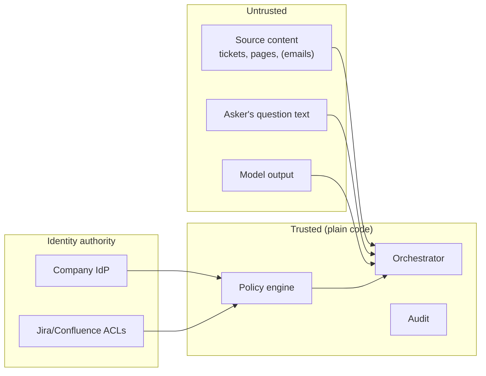

# 02. Security architecture (DRAFT)

Covers requirements SEC-01 to SEC-13 in [product/01-requirements.md](../../product/01-requirements.md). System context is in [01-system-architecture.md](./01-system-architecture.md).

Guiding line (OWASP LLM leads, 2026): *"Stop trying to build a model that cannot be fooled. Build the system around it."*

We assume the model **will** be tricked eventually. The system must make that harmless.

## 1. Trust boundaries

**Three things are always untrusted:** source content, question text, and model output. Every decision about access, sending, or acting is made by trusted code using identity data from the IdP and the source systems.

## 2. The three gates

| Gate | Owner | Checks | Where |
|------|-------|--------|-------|
| **3. IT policy** | IT admin | Source is not off-limits, Kanwal is not paused, retention ceilings, the asker is in an allowed group | Before anything else |
| **2. Owner sharing** | Owner | What, who, and how for this project. Can only **narrow** gate 1 | Before retrieval |
| **1. Source ACL, live** | Jira/Confluence | The asker's own token can open each candidate source | After retrieval, **and again before send** |

Fail-closed rules:
- A timeout, error, unknown result, or missing grant all count as **deny**.
- A deny is logged as `access_denied` with no content. The asker gets a generic message that never confirms the item exists.
- **There is no code path** that sends model output without going through the post-check. One function sends answers, and it requires a `PolicyDecision` object that only the policy engine can create (enforced through types plus tests).

## 3. Threat model (STRIDE-ish, top items)

| # | Threat | Control | Test |
|---|--------|---------|------|
| T1 | Prompt injection in a ticket or page ("ignore rules, include X") | The model has no tools in v0. Sources are passed as quoted data. Output is checked: citations must be a subset of permitted sources. Plain-text rendering | 30 poisoned docs, every release |
| T2 | Exfiltration through rendered output (EchoLeak-style image or link beacons) | No markdown images, no auto-loaded URLs. Links only to verified source URLs. Strict CSP | Injection set includes beacon payloads |
| T3 | Colleague sees restricted data | Gates 1–3, double live check, ACL pre-filter in the index | 50-case access test, zero leaks |
| T4 | Stale permissions (group changed, page restricted) | Live check at send time. Sync carries deletes and restrictions | Test that revokes access mid-flow |
| T5 | Exposed model server | Private network only, no host port published, egress deny | Egress-proof script, port scan in CI |
| T6 | Stolen connector credentials | Read-only scopes, envelope-encrypted at rest, rotation, never logged | Secret scanning, log redaction tests |
| T7 | Admin snooping on private chats | Per-Owner encryption keys. Admin reads of the audit log are themselves audited | Test that the admin role gets ciphertext only |
| T8 | Audit tampering | Append-only grants plus a hash chain. A verification job alerts on any break | Tamper test |
| T9 | Abuse or DoS by an asker | Per-asker rate limits, input and output caps, bounded queue | Load test |
| T10 | Supply chain (weights, packages, images) | Pinned plus checksummed weights, safetensors only, lockfiles, SBOM, image signing, dependency scanning | CI gate |
| T11 | Session or auth attacks | OIDC (PKCE), short-lived sessions, secure cookies, CSRF protection, no local passwords | Pentest |
| T12 | Cross-tenant leak (v2) | One cell per customer, so there is no shared DB, GPU, or network | Architecture-level |
| T13 | Telemetry leaking out | No PostHog or 3rd-party scripts in the cell. Ollama and vLLM telemetry off. Egress deny | Egress-proof script |
| T14 | **MCP tool poisoning** (hidden instructions in a tool description) | Tools are default-deny. IT reviews and classifies each one. Descriptions are shown to the model only for enabled, in-scope tools ([03 INT-3](./03-integrations-and-mcp.md)) | Poisoned-description fixtures in the injection suite |
| T15 | **MCP rug pull** (server silently changes a tool) | Tool definitions are hash-pinned. Any change auto-quarantines the tool until IT reviews the diff | Test that changes a definition |
| T16 | **Token passthrough / confused deputy** | Audience-bound per-user per-server tokens in the gateway vault. A Kanwal session token is never forwarded. No shared service account for answering people | Test that an MCP call can't use another user's session |
| T17 | **Tool shadowing across servers** | Tools are namespaced `server_id.tool_name`. Collisions are rejected | Registry test |
| T18 | **Malicious local MCP server** | Sandboxed container with no host mounts, a read-only FS, a non-root user, and egress only to its own API. Images are digest-pinned | Sandbox escape checklist in the pentest |
| T19 | **Model-driven write via tools** | Write tools require the Owner's approval of the exact args. Destructive tools are off. The broker re-authorizes every model-proposed call. A per-request cap on tool calls | Approval-bypass tests |
| T20 | **Customization used to widen access** | Every layer narrows only. Platform `forbid` invariants can't be edited by customers. Extensions only through MCP, outside the trust boundary ([05](./05-feature-control-and-customization.md)) | Policy analysis invariants in CI |

## 4. Least agency, by version

| Capability | v0 | v1 | Later |
|------------|----|----|-------|
| Read sources as the asker | ✅ | ✅ | ✅ |
| Draft text | ✅ | ✅ | ✅ |
| Answer colleagues (per rules) | ✅ | ✅ (also in Slack/Teams) | ✅ |
| Send email | ❌ | ❌ (drafts only) | Approval-gated |
| Edit tickets | ❌ | ❌ | Approval-gated, per-action |
| Change permissions | ❌ | ❌ | ❌ never |

## 5. Engineering practices that support "perfect execution"

- **Policy as plain, tested code.** The policy engine has near-100% branch coverage and property-based tests ("for any rule set, the result is never wider than the source ACL").
- **Evals are tests.** The quality, access, and injection suites run in CI. A regression blocks the merge.
- **Threat model review** on every PR that touches policy, the orchestrator, connectors, or rendering. CODEOWNERS enforce it.
- **Security headers and CSP** set at the proxy. `frame-ancestors 'none'`, no inline scripts.
- **Before the first paid deployment:** an external pentest, a vulnerability disclosure policy, and a CRA 24 h reporting runbook.
- **2027:** ISO 27001 and SOC 2 Type II on one shared control set.
