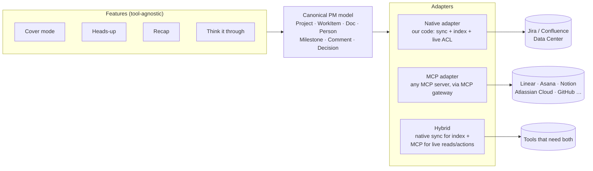
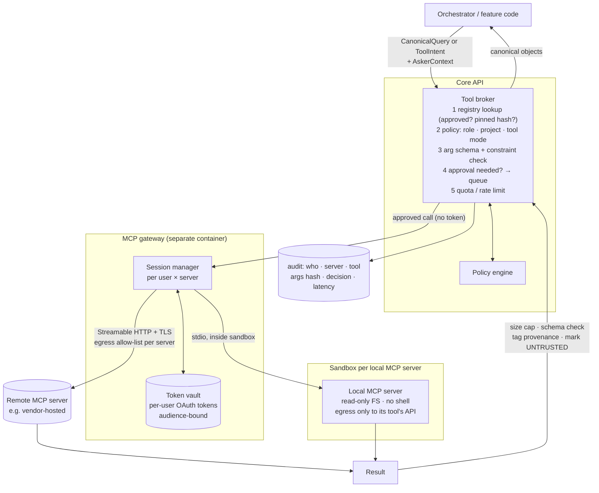
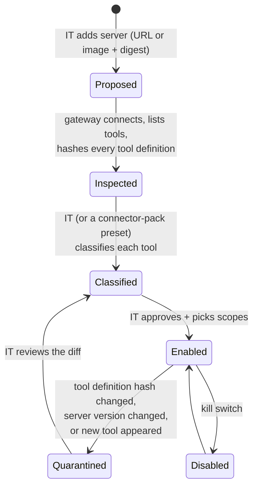
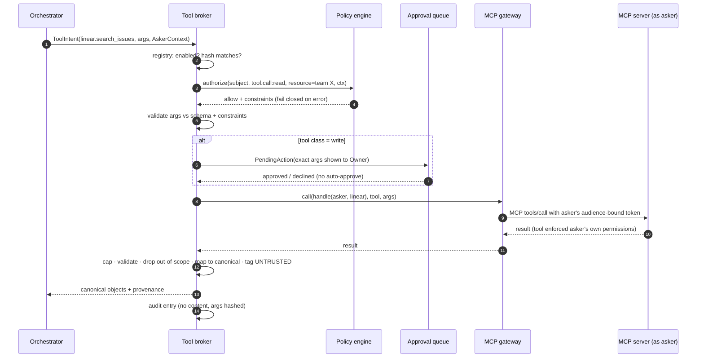

# 03. Integrations and MCP (DRAFT)

How Kanwal connects to project-management tools and other systems, **including any tool that ships an MCP server**, while keeping every call authenticated, authorized, scoped, and audited.

Related: [01 System architecture](./01-system-architecture.md) · [02 Security architecture](./02-security-architecture.md) · [05 Feature control and customization](./05-feature-control-and-customization.md)

---

## INT-0. Design goals

1. **Add a PM tool without writing a connector** when the tool ships an MCP server (Linear, Atlassian, Asana, Notion, GitHub, monday.com, …).
2. **Write a native connector only when MCP can't meet our rules**, for example where there's no MCP server (Jira/Confluence Data Center), or where we need incremental sync with deletes for the search index.
3. **Every call runs as the asker**, with the asker's own token. The tool enforces its own permissions, so we never rebuild them.
4. **Default deny.** A new server, a new tool, or a changed tool definition stays disabled until IT approves it.
5. **Features talk to a canonical PM model, not to tool APIs.** Then heads-up, recap, and cover mode work the same on Jira, Linear, or Asana.

## INT-1. One connector interface, three adapter types



| Adapter | Use when | Gives us | Limits |
|---------|----------|----------|--------|
| **Native** | No usable MCP server, or we need full sync and an index | Incremental sync, delete propagation, a live ACL check, webhooks | We write and maintain the code |
| **MCP** | The tool ships a trustworthy MCP server | Fast onboarding of new tools. Live calls as the asker | No standard sync or delete semantics, so it's **live query only** and its content isn't indexed. Search uses the tool's own search tool |
| **Hybrid** | A large corpus needs the index, but live reads and actions should use MCP | The best of both | Two code paths to test |

**Canonical model mapping.** Each connector ships a **mapping** from tool objects to canonical objects. For example, a Linear `Issue` maps to a `WorkItem` with fields like `{state, assignee, due, blockers}`. The mapping is declarative where possible (YAML plus small transforms). Features only ever see canonical objects with **provenance**: `source`, `source_id`, `url`, and `fetched_as_user`.

```python
# Contract sketch, not final
class Connector(Protocol):
    id: str                                   # "linear", "jira-dc"
    adapter: Literal["native", "mcp", "hybrid"]
    capabilities: set[Capability]             # read.search, read.item, read.acl_live,
                                              # sync.incremental, sync.deletes,
                                              # write.comment, write.create_item, ...
    def search(self, ctx: AskerContext, q: CanonicalQuery) -> list[CanonicalRef]: ...
    def get(self, ctx: AskerContext, ref: CanonicalRef) -> CanonicalObject: ...
    def check_access(self, ctx: AskerContext, refs: list[CanonicalRef]) -> dict[CanonicalRef, bool]: ...
    def sync(self, cursor: Cursor) -> Iterator[Change]: ...          # native/hybrid only
    def propose_action(self, ctx: AskerContext, a: CanonicalAction) -> PendingAction: ...  # never executes
```

`AskerContext` is created only by the policy engine. It holds **the asker's identity and a handle** to their token. It never holds the token itself.

## INT-2. The MCP gateway and tool broker

All MCP traffic goes through **two components inside the cell**:

- **Tool broker** (policy side): decides whether a tool call may happen.
- **MCP gateway** (transport side): holds the tokens, owns the MCP sessions, enforces egress, and sandboxes local servers.



Hard rules:
- **No token passthrough.** The gateway gets its own audience-bound token per server per user (MCP authorization: OAuth 2.1 + PKCE, with resource indicators). The asker's Kanwal session token is **never** forwarded to an MCP server.
- **Tokens never reach the model, the browser, or the logs.** The broker and orchestrator only hold opaque handles.
- **One session per user per server.** A call for asker A can never use asker B's session. Shared service accounts are allowed **only** for native background sync, never for answering a person.
- **Local MCP servers run sandboxed.** Each has its own container with no host mounts, a read-only filesystem, a non-root user, CPU and memory limits, and egress limited to that tool's API host.
- **Results are untrusted data.** They're size-capped, validated against the tool's declared output schema where one exists, mapped to canonical objects, and passed to the model only as quoted data (same rule as documents).

## INT-3. Server and tool lifecycle (default deny)



**Tool classification.** Every tool gets exactly one class. A tool with no class is `blocked`.

| Class | Meaning | Allowed modes |
|-------|---------|---------------|
| `read` | No side effects (search, get issue, list projects) | `off`, `auto` |
| `write` | Changes something reversible (comment, create issue, update field) | `off`, `approve` (the Owner approves the exact call) |
| `destructive` | Hard to reverse (delete, transition to closed, change permissions, send externally) | `off` only in v0/v1 |
| `blocked` | Unknown or not reviewed | none |

- **Pinning:** we store a hash of each tool's name, description, and input/output schema. Any change (a "rug pull") quarantines that tool automatically.
- **Tool descriptions are untrusted too.** They are shown to the model only for tools that are enabled and in scope for this asker, and only after IT has reviewed them. Hidden instructions in descriptions ("tool poisoning") are a known MCP attack.
- **Name collisions across servers** are rejected. Tools are always addressed as `server_id.tool_name`, so one server can't shadow another's tool.

## INT-4. Access control model for integrations

Authorization is evaluated per call, as **policy(subject, action, resource, context)**:

| Dimension | Examples | Set by |
|-----------|----------|--------|
| **Subject** | User, IdP groups, Kanwal role (Owner / Asker / IT / Auditor), persona | IdP + IT |
| **Action** | `server.use`, `tool.call:read`, `tool.call:write` | Tool class |
| **Resource** | Server, tool, and the **target inside the tool** (project key, team, workspace) taken from the arguments | IT + Owner sharing rules |
| **Context** | Deployment profile, license, Owner's mode for this project, time, quota left, approval state | System |

Rules:
1. **Effective permission = source permission (enforced by the tool, as the asker) ∩ IT policy ∩ Owner sharing ∩ tool mode ∩ license and profile.** Every layer can only narrow. See [05](./05-feature-control-and-customization.md).
2. **Argument constraints.** Policies can pin arguments. For example, `linear.search_issues` may only be called with `teamId ∈ owner.shared_teams`. The broker checks this **before** the call. A tool result outside the allowed scope is dropped after the call (defense in depth).
3. **Per-user consent.** Each person connects each tool once (OAuth). Without consent there are no calls as that person. Kanwal tells them so and sends nothing.
4. **Offboarding.** IdP deprovisioning (SCIM, or the next login check) revokes all of that user's tokens and sessions in the gateway.
5. **Quotas.** Per user, per server, and per tool rate limits, plus a per-request cap on tool calls (e.g. ≤ 8), so the model can't loop.



## INT-5. Who is allowed to call tools

| Stage | Who picks the tool call | Allowed tool classes |
|-------|-------------------------|----------------------|
| **v0** | **Plain code only.** The router maps intents (e.g. "status of X", "who owns Y") to fixed read calls | `read` |
| **v1** | The model may **propose** calls from a tool list that the broker has already filtered for this asker, project, and profile | `read` (`auto`), `write` (`approve`) |
| **Later** | Declarative workflows ([05](./05-feature-control-and-customization.md)), triggered by events | `read`, `write` (`approve`) |

The model never sees tools that the asker or the Owner's rules don't allow. Even when it proposes a call, the broker re-authorizes it as if it came from an untrusted source, **because it did**.

## INT-6. Adding a new PM tool

**For IT (no code from us):**
1. Admin → Integrations → *Add MCP server*: a remote URL, or a container image with its digest.
2. Kanwal inspects it and lists the tools. IT applies a **connector pack** preset if one exists, or classifies the tools by hand.
3. IT picks scopes: which groups may use it, and which projects or teams. IT sets tool modes.
4. Users connect their accounts (OAuth) the first time they need it.

**For us (to make a tool "first-class"):** ship a **connector pack**. It's a declarative bundle containing:
- the server reference (official source, pinned version or digest)
- a tool classification preset
- the canonical model mapping
- default heads-up rules for that tool (e.g. Linear cycle at risk)
- copy, plus a test fixture set (access and injection cases)

Packs are signed and versioned, and each one has an entitlement key (`connector.linear`).

**Candidate PM tools** (MCP availability to be checked in the integrations spike; vendors change these often):

| Tool | Likely adapter | Note |
|------|----------------|------|
| Jira / Confluence **Data Center** | Native | No vendor MCP for DC expected. This is the v0 path |
| Jira / Confluence **Cloud** | MCP (Atlassian remote MCP) or native | Check scopes and whether it can act fully as the user |
| Linear | MCP (official) | v1 source per requirements |
| Asana, monday.com, ClickUp, Notion | MCP | Check each vendor's official server and OAuth support |
| GitHub / GitLab | MCP | Useful for an eng-lead persona |
| Slack / Teams | Native channel connector | These are *channels*, not sources. See ARCH-3 in [01](./01-system-architecture.md) |

## INT-7. Kanwal as an MCP server (later, off by default)

Kanwal could also **expose** itself as an MCP server, so people could use "Ask Kanwal" from Claude Desktop, IDEs, or other agents. If we build it:
- It's behind the entitlement `surface.mcp_server` and off by default.
- Clients authenticate through the company IdP (OAuth). There are no API keys.
- It exposes **only** Kanwal's own question tool, which goes through the same three gates. It exposes no raw tool passthrough to underlying sources.
- It's a channel like Slack. Every answer is labeled, audited, and listed in the recap.

Decision: D-14.
