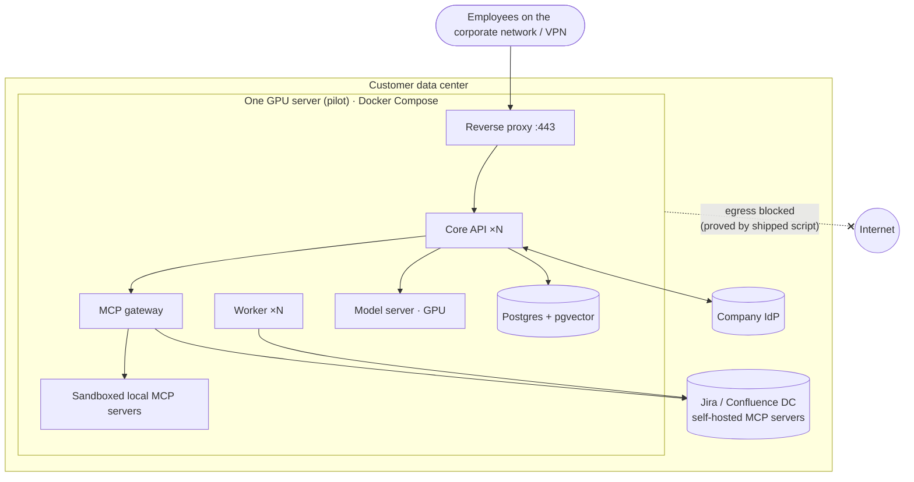
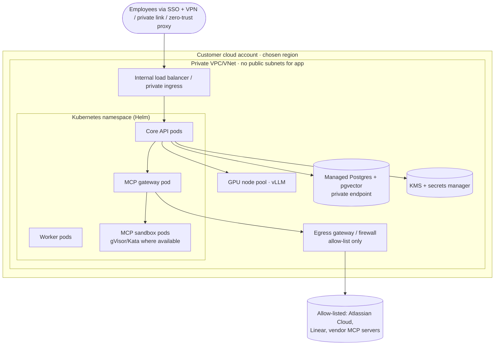
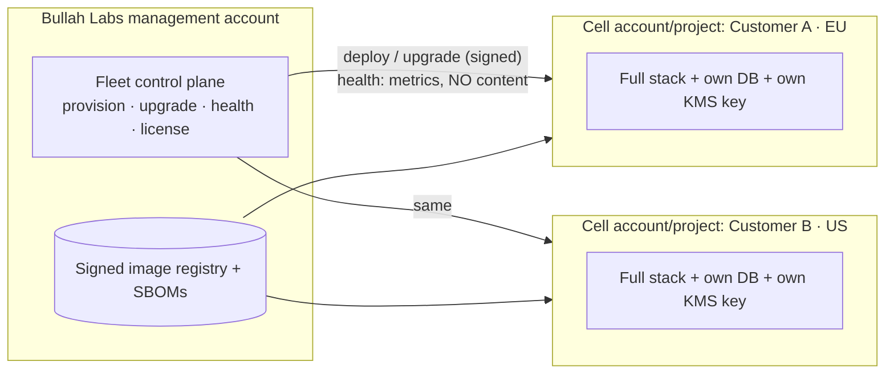
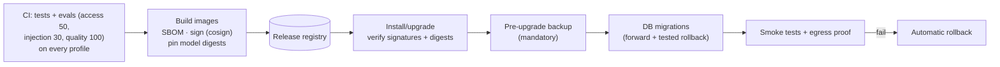

# 04. Deployment: local and cloud (DRAFT)

**One codebase, one set of signed images, several deployment profiles.** A customer can run Kanwal on their own hardware or in a cloud, and can move between the two without any change in behavior or security model.

Related: [01 System architecture (ARCH-0 cells)](./01-system-architecture.md) · [05 Feature control](./05-feature-control-and-customization.md)

---

## DEP-0. Profiles

A **profile** is a signed config bundle chosen at install. It sets infrastructure choices **and security ceilings**. A profile can only make the system *more* restrictive than the build allows, and IT can only narrow it further.

| | `local` | `private-cloud` | `managed` | `dev` |
|---|---|---|---|---|
| **Where** | Customer's data center or a single server | Customer's own AWS / Azure / GCP account, in their region | Our cloud, **one isolated cell per customer**, in a region the customer picks | A developer laptop |
| **Who operates** | Customer IT | Customer IT (we help) | Bullah Labs | Us |
| **When** | v0 | v1 | v2 | now |
| **Packaging** | Docker Compose (single host). Offline bundle in v1 | Helm chart + Terraform module per cloud | Same Helm + Terraform, driven by the fleet control plane | Compose + hot reload |
| **Database** | Postgres container with an encrypted volume | Managed Postgres with pgvector (RDS / Azure DB / Cloud SQL), or a container | Managed Postgres, per-cell instance, per-cell KMS key | Container |
| **Models** | Local GPU (Ollama → vLLM) | GPU node pool **or** a customer-approved in-region model endpoint | Per-cell GPU, or an in-region hosted open model ("lite cell") | Local or a hosted dev key |
| **Secrets** | File-mounted secrets, envelope-encrypted | Cloud secrets manager + KMS | Per-cell secrets manager + KMS key | `.env` (dev only) |
| **MCP servers allowed** | Local (sandboxed) + self-hosted. **Remote vendor MCP is off by default** | Local + self-hosted + remote vendor MCP **on the egress allow-list** | Same as private-cloud | All (test only) |
| **External model APIs** | **Hard off** | Off by default. IT can enable a specific in-region endpoint | Off by default, per contract | Allowed |
| **Egress** | Deny-all except the customer's tools | Deny-all + allow-list (security groups / firewall policy) | Deny-all + per-cell allow-list | Open |
| **Updates** | Customer pulls a signed release when they choose | Customer's pipeline pulls signed releases | Canary rollout by the fleet control plane, in maintenance windows the customer agrees | Continuous |
| **Licensing** | Signed file | Signed file | Pushed by the control plane | Dev license |

## DEP-1. Local (on-prem)

- Reachable only from the corporate network or VPN. **No public ingress.**
- Remote vendor MCP servers (internet-hosted) need IT to put that host on the egress allow-list explicitly. That shows up in "What Kanwal knows" as *data leaves your network to: …*.
- Larger sites can split across hosts: the model server on a GPU host, the API and workers on CPU hosts.

## DEP-2. Private cloud (customer account)

- The Terraform module creates the network, the managed Postgres, KMS, the GPU pool, and the egress firewall. Helm deploys the app. Both are versioned with the release.
- Ingress is private by default. A public endpoint is optional and only behind the company's zero-trust proxy or IdP-aware proxy.
- Network policies inside the cluster are default-deny. Only the MCP gateway may reach the egress gateway. Only the API and workers may reach Postgres and the model server.

## DEP-3. Managed (our cloud, one cell per customer)

- **Each customer gets a separate cloud account or project**, not just a namespace. That means separate IAM, network, KMS key, database, and GPU.
- **Our operators have no standing access to cell data.** Break-glass access needs a customer-approved ticket, is time-boxed, and is audited inside the cell.
- The control plane receives health and usage **totals only** (the same no-text rule as the events table).
- **No pooled multi-tenant tier**, even for small customers (decision D-16). A "lite cell" without a GPU, using an in-region hosted open model, is the cheap option.

## DEP-4. What stays identical across profiles

These never change by profile, and tests run against every profile in CI:
- The three access gates, fail closed, and the tool broker rules.
- Audit (append-only plus hash chain) and the events table with no text.
- Retention, export, delete, and the pause switch.
- OIDC sign-in with no local passwords.
- Signed images, SBOM, and pinned model weights.

## DEP-5. Release, install, upgrade

- The installer refuses to run with unsigned images, or with digests that don't match the release manifest.
- Every upgrade starts with a backup and ends with the egress-proof script plus smoke tests.
- Restore drills: before every release (NFR-04).

## DEP-6. Sizing per profile (starting points, to measure)

| Size | Owners | Local | Private cloud |
|------|--------|-------|---------------|
| Pilot | ≤ 10 | 1 server: 24 GB GPU, 8 cores, 64 GB RAM, 500 GB NVMe | 1 GPU node (L4/A10-class) + small managed Postgres |
| Team | ≤ 50 | GPU host (48 GB+) + 1 app host | GPU pool of 2, 2–3 API pods, managed Postgres (medium) |
| Org | 50+ | Multiple GPU hosts, Postgres primary + replica | Autoscaling API/worker pods, GPU pool autoscaling, read replica |
