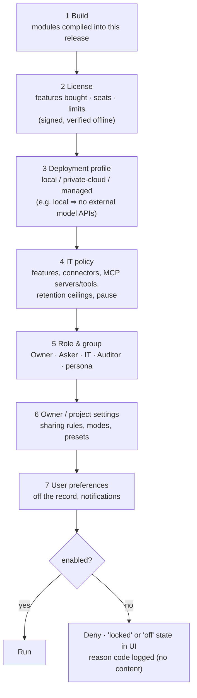

# 05. Feature control and customization (DRAFT)

How we **restrict** features (by license, deployment, IT, role, and project) and how customers can **customize** and **extend** Kanwal without being able to weaken its security.

Related: [03 Integrations and MCP](./03-integrations-and-mcp.md) · [04 Deployment](./04-deployment.md)

---

## FC-0. The one invariant

> **Every layer can only narrow. No setting, rule, template, pack, or extension can widen access, skip a gate, skip approval, or skip the audit.**

This holds because customizations run *inside* the orchestrator and tool broker, which call the policy engine on every action. None of them get a path around it.

## FC-1. Layered evaluation



- **Result = the intersection of all layers.** Each layer is a pure function of `(feature, subject, context) → allow | deny(reason)`.
- **Errors mean deny** (fail closed), the same as access checks.
- The UI asks `GET /me/capabilities` for what to show. The **server enforces it again** on every route, job, and tool call.
- Reason codes (`license`, `profile`, `it_policy`, `role`, `owner_rule`) let the UI say why a feature is unavailable, and who can change that, without leaking anything.

## FC-2. Feature registry

Every feature, connector, persona, and surface is declared in a **manifest**. Nothing runs unless it's in the registry.

```yaml
# Sketch, not final
key: heads_up.release_risk
version: 1.2.0
kind: feature            # feature | connector | persona | surface | workflow
depends_on: [core.events, connector.any:read.item]
requires_capabilities: [read.search, read.item]   # from connectors/MCP tools
tool_classes: [read]                               # max agency it may use
risk: low                # low | medium | high → high needs IT opt-in
default: off             # everything starts off unless the license + IT enable it
profiles: [local, private-cloud, managed]
roles: [owner]
settings_schema: ./settings.schema.json            # validated, typed
metrics: [blockers_flagged_before_standup]          # "every feature ships with its metric"
kill_switch: true
privacy:                 # REQUIRED: data footprint, see 06-privacy-architecture PRIV-2
  data_stored: []        # this feature only reads; stores nothing new
  data_leaves_cell: none
  model_calls: local_only
```

- **The registry is code.** It's reviewed and versioned, and CI checks that every route, job, and tool call is tied to a registered key. A test fails if a route has no feature guard.
- **Kill switches** exist at every level: the whole cell (the pause switch), per feature, per connector, per MCP server, per tool. A kill switch takes effect immediately, without a restart.
- **Dependencies are resolved at evaluation time.** Turning off `connector.jira` automatically turns off any feature that only Jira could satisfy, with a clear reason.

## FC-3. Customization levels (safest to most powerful)

| Level | What customers can change | Who | Guardrail | When |
|-------|---------------------------|-----|-----------|------|
| **1. Settings** | Thresholds, minutes per event, retention within ceilings, presets | Owner / IT | Schema-validated, with bounds from the registry | v0 |
| **2. Rules and policies** | Sharing rules, IT policies (who can use which tool, on which projects) | Owner / IT | Policies are evaluated by our engine and can only narrow. "Preview as" and a policy test tool | v0 (rules), v1 (custom IT policies) |
| **3. Templates and copy** | Answer templates, recap layout, wording, language | IT / Owner | Versioned. Templates can't contain instructions that change tools or recipients. Rendered through the plain-text renderer | v1 |
| **4. Packs** | Persona packs (new roles), connector packs (new PM tools via MCP) | Us, IT, or partners | Declarative, signed, with an entitlement key per pack. They declare max tool class and risk | v1 |
| **5. Workflows** | "When X happens, do Y". Example: *release at risk → draft a note to stakeholders → Owner approves* | IT / Owner | Triggers come only from the event log. Steps use only approved tools. Any `write` step requires approval. A per-workflow quota | v2 |
| **6. Custom extensions** | New capabilities built by the customer | Customer devs | **Built as an MCP server** that the customer runs. It plugs in through the gateway like any other tool: classified, pinned, scoped, sandboxed, audited. No in-process plugins | v2 |

Why extensions go through MCP rather than in-process plugins: an in-process plugin would run inside the trusted core and could bypass the policy engine. An MCP server runs **outside** the trust boundary, so all of our controls apply to it automatically.

## FC-4. Customer-authored policies (v1)

Owner sharing rules are a fixed, simple model (what, who, how). For IT we want richer policies that customers can write themselves, but that we can still **analyze and test**.

Proposal: evaluate **[Cedar](https://www.cedarpolicy.com/)** for IT policies (decision D-12).
- It's an embeddable library: no network service, and it works offline in every profile.
- It's **deny-overrides** with default deny, which matches our "fail closed" rule.
- Policies can be analyzed (e.g. "can any policy let an Asker call a `write` tool without approval?"), and we can ship those checks as invariants.

Example:
```cedar
// Designers may use Linear read tools, only for the Design team
permit (principal in Group::"design", action == Action::"tool.call.read", resource in Server::"linear")
when { resource.team == "DESIGN" };

// Hard platform invariant (shipped by us, not editable): write tools always need approval
forbid (principal, action == Action::"tool.call.write", resource)
unless { context.approved_by_owner == true };
```

Platform invariants (the `forbid` rules we ship) live in a separate policy set that customers **can't edit or override**.

## FC-5. Personas: from PMs to other roles

A persona pack is one kind of pack (level 4). It bundles default sharing presets, heads-up rules, north-star options, required connectors or capabilities, and copy. Adding a persona (eng lead, designer, account manager) means **a new pack, not new core code**. If a persona needs new core code, that's a signal the core abstraction is wrong.

## FC-6. What this means for code (applies now, v0)

- Every API route and job declares its feature key with a decorator or dependency. A route without one fails CI.
- Feature checks call the one `capabilities.evaluate()`. No scattered `if license.has(...)`.
- Settings are read only through typed settings objects generated from `settings_schema`.
- **Build the layer interfaces in v0, even if some layers are trivial** (e.g. profile = `local` only, policies = built-in only). That's cheap now and expensive to retrofit.
